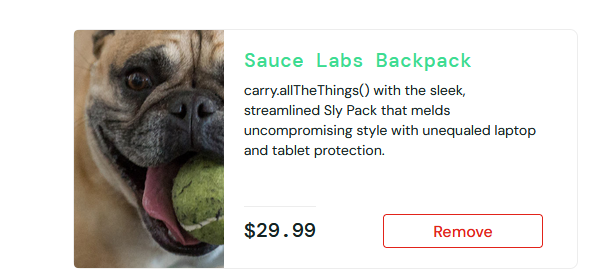
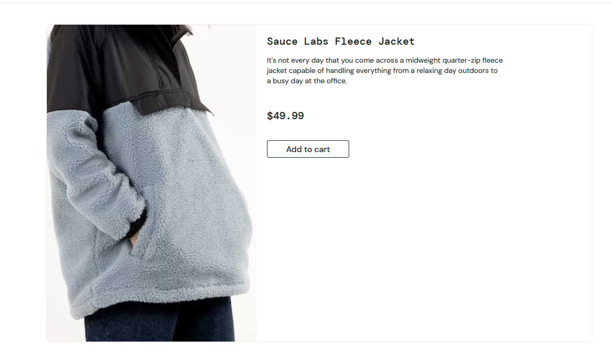

# Manual QA Portfolio: Swag Labs (Sauce Demo)

A complete manual testing project for [Swag Labs](https://www.saucedemo.com), the public demo e-commerce app that Sauce Labs provides for testing practice. It contains a test plan, a 45-case test suite, 14 findings tracked in Jira with a traceability matrix back to the test cases, and screenshot evidence.

> Personal practice project against a public demo application. Some behaviour may be an intentional teaching artifact rather than an unintended defect, so each finding was judged on its own merits.

|---|---|
| Test cases | **45** across 5 modules (written and managed in TestRail) |
| Findings logged in Jira | **14**: 13 bugs and 1 UX suggestion |
| Test cases that surfaced a defect | 8 of 45 |
| Bugs by Jira priority | 6 High · 5 Medium · 2 Low |
| Bugs by severity | 9 Major · 4 Minor |
| Coverage gap found | 1: cart quantity behaviour had no test case (KAN-15) |
| Screenshot evidence | KAN-6, KAN-8, KAN-9, KAN-12 |

## What's in this repository

```
manual-qa-portfolio/
├── docs/Master_Test_Plan.docx          scope, approach, environment, results summary
├── test-suite/Test_Cases.xlsx          45 cases, one tab per module
├── defects/Bug_Report.xlsx             14 findings with steps, expected/actual, severity, priority
├── traceability/RTM.xlsx               requirement → test case → defect matrix
└── evidence/                           screenshots referenced from the bug report
```

## What was tested

| Module | Cases | Focus |
|---|---|---|
| Auth | 10 | valid and invalid login, empty fields, locked-out user, username case and trailing space, logout and session end |
| Products Page and Sorting | 11 | product listing, all four sort options, sort persistence, product detail pages, `problem_user` behaviour |
| Cart | 10 | add and remove, badge accuracy, rapid clicking, persistence, empty-cart state |
| Checkout | 10 | required fields, order summary and totals, cancel paths, very long and very short input, `problem_user` checkout |
| Menu and Other Stuff | 4 | menu links, Reset App State, `performance_glitch_user` load time |

The suite mixes positive, negative, validation and edge cases, and repeats key flows with the `problem_user` account to isolate account-specific defects.

## Notable findings

- **`problem_user` accounts for 7 of the 14 findings**: sorting does nothing (KAN-4), every product shows the same placeholder image (KAN-6), some products can't be added to the cart (KAN-7), clicking a product opens a different product (KAN-8) or an "item not found" page (KAN-9), the cart badge counts an item that never reaches the cart (KAN-11), and typing in the Last Name field at checkout lands in First Name (KAN-16).
- **Cart contents carry over between different accounts** (KAN-10). A data-isolation problem like this would be far more serious in a production shop.
- **Checkout works with an empty cart**: the button stays active (KAN-13) and the whole flow can be completed (KAN-14), most likely one missing check behind both.
- **A finding with no matching test case**: KAN-15 (quantity can't be changed) is recorded in the RTM as a coverage gap, so a test case still needs to be added for it.
- **Not everything is a bug.** KAN-12 ("Back to products" ignores that the user came from the cart) is logged as a *Suggestion*, because the link behaves as labelled.

### Example: KAN-8, clicking a product opens the wrong product

<table>
  <tr>
    <td></td>
    <td></td>
  </tr>
  <tr>
    <td align="center">Clicked: Sauce Labs Backpack</td>
    <td align="center">Opened: Sauce Labs Fleece Jacket</td>
  </tr>
</table>

## How the pieces connect

Every finding in `Bug_Report.xlsx` carries its Jira key and the test case it came from. `RTM.xlsx` runs the other way: for each requirement it lists the covering test cases and any defects logged against them, so gaps are visible (a requirement with no test case, a test case with no defects).

## Tools

TestRail for test cases, Jira for defects, and Microsoft Excel and Word for the exported deliverables.

## Notes on the data

- Priority and status come straight from Jira. All findings are currently *To Do*.
- Severity is my own assessment, since Jira has no severity field in this project.

## Author

Vladyslav Saulenko, QA Engineer · [GitHub](https://github.com/voidtess) · [LinkedIn](https://www.linkedin.com/in/voidtess)
